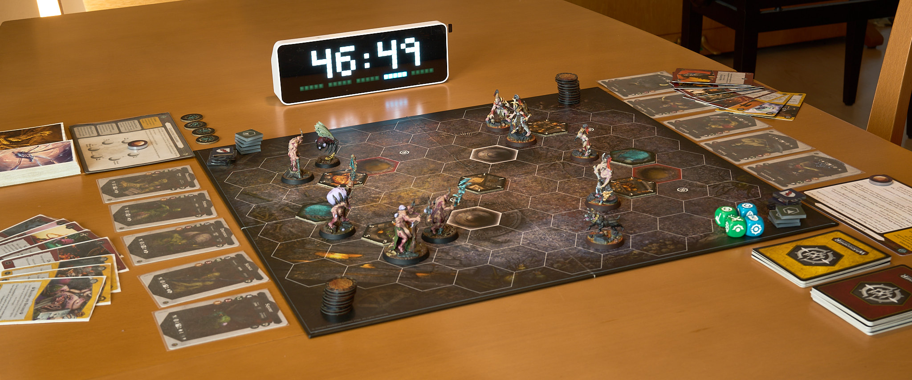
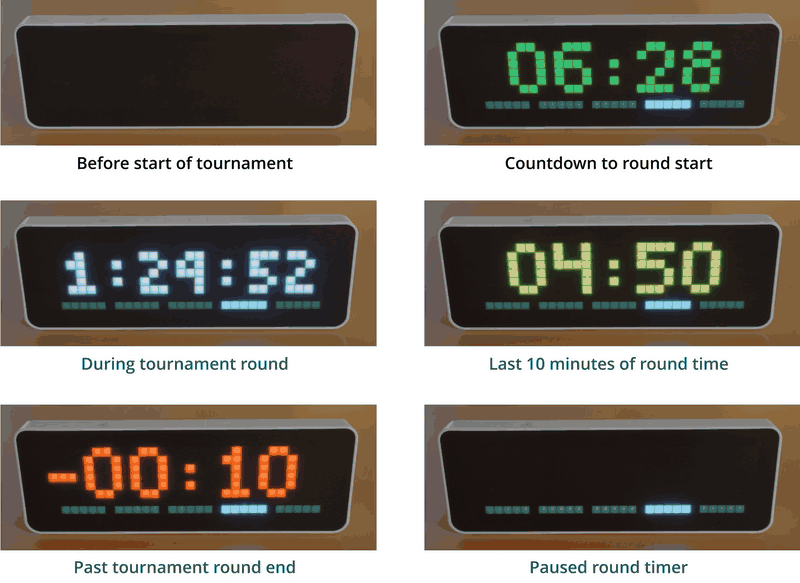
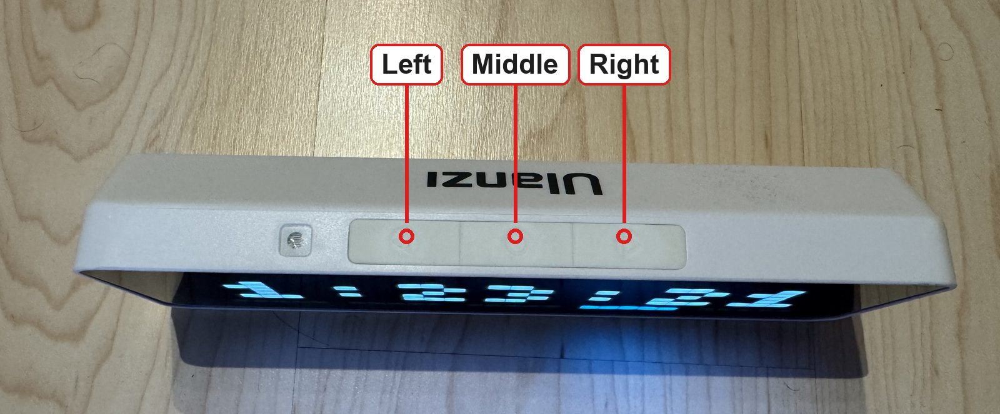
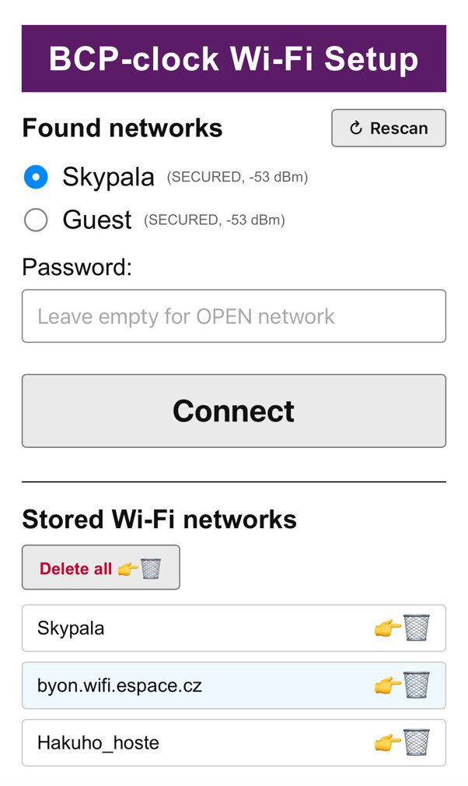
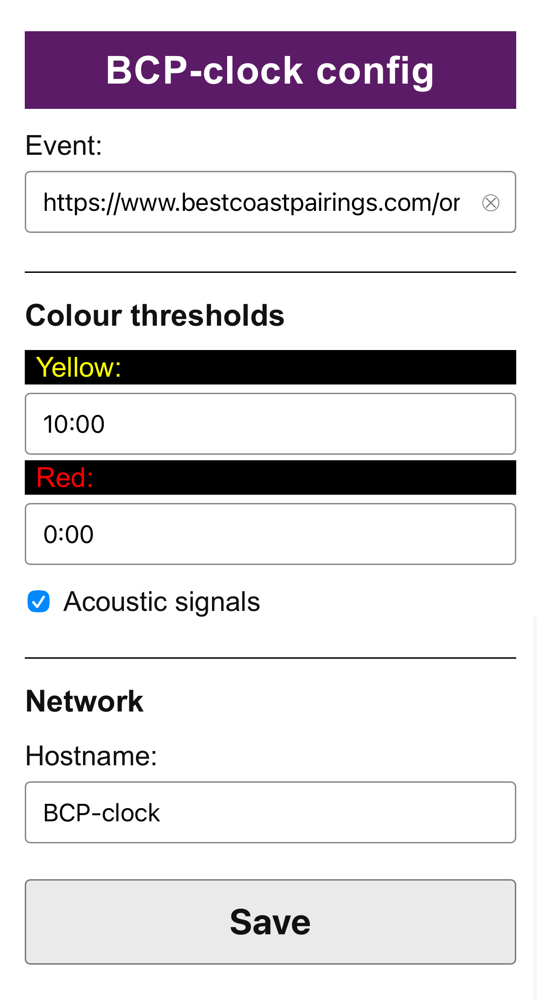

# BCP Clock

**A tournament round timer for the Ulanzi TC001 pixel clock, fed live from [Best Coast Pairings](https://www.bestcoastpairings.com).**
**Works with any game system, as long as the tournament is run on BCP.**

[](https://platformio.org/)
[](https://www.espressif.com/en/products/socs/esp32)
[](https://docs.arduino.cc/)
[](http://www.wtfpl.net/)
[](https://github.com/honzaskypala/bcp-clock/releases/latest)



BCP Clock is custom firmware for the Ulanzi TC001 desktop pixel clock. Enter a Best Coast Pairings event once, and the clock shows the official round
timer of that tournament: time to round start, the running countdown, a paused timer and overtime,
with colours that change as the end of the round approaches. Put one on each table or next to the
judges' desk and nobody has to check their phone.

## Contents

- [Features](#features)
- [Modes](#modes)
- [What the display shows](#what-the-display-shows)
- [Hardware](#hardware)
- [Installation](#installation)
- [First setup](#first-setup)
- [Configuration](#configuration)
- [How it works](#how-it-works)
- [Testing](#testing)
- [Troubleshooting](#troubleshooting)
- [Roadmap](#roadmap)
- [History](#history)
- [Disclaimer](#disclaimer)
- [License](#license)
- [Credits](#credits)

## Features

- **Live BCP round timer**: follows the timer the tournament organiser runs in Best Coast Pairings.
- **Time to round start**, **running countdown**, **paused timer** and **overtime**, each with its own colour.
- **Configurable yellow and red thresholds** for the last minutes of a round.
- **Round indicator** on the bottom row: which round of how many is being played.
- **Event name and round number** when no timer is running.
- **UTF-8 text** on the display, including Latin Extended-A and Cyrillic, so event names with
  diacritics are shown correctly.
- **WiFi manager with captive portal**: stores several networks and connects to whichever is available.
- **Accurate time** from NTP, with the built-in RTC as a fallback.
- **Web configuration page** served by the clock itself, usable from a phone.
- **Self-recovery**: the clock reboots itself after repeated connection failures.
- **Modes**: switched with the middle button, the clock returns to the last one after a restart.

## Modes

The clock works in one of several modes; a short press of the middle button switches to the next one.

| Mode | Name on the display | What it does |
|---|---|---|
| BCP mode | `BCP mode` | Countdown of the round timer of a tournament on Best Coast Pairings (see below) |
| Offline mode | `Offline` | Countdown of a round length set on the configuration page, started and paused with the buttons; no internet needed |
| Chess clock | `Chess clock` | Two players, each with half of the round length set on the configuration page; no internet needed |

### Offline mode

A countdown for games without Best Coast Pairings. Its length is set on the configuration page (default
`1:00:00`). It uses the same colours, yellow and red thresholds and acoustic signals as BCP mode; there is no
round indicator and no connection indicator (the low battery warning stays).

| Button | Action |
|---|---|
| Right | Starts the countdown, or resumes it when paused |
| Middle (short) | Running: pauses it (the time blinks magenta). Stopped: switches to the next mode |
| Left | Stopped: resets it to the configured length. Running: nothing |

The countdown is computed from its end time, so it keeps running while the clock is switched off or in
another mode, and continues as if nothing happened when you come back. A white time is a countdown that has
not been started yet. After zero it keeps counting into overtime in red. A new length from the configuration
page applies at once to a countdown that has not been started, otherwise after the next reset.

### Chess clock

Each player gets half of the round length set on the configuration page (default `1:00:00` for the whole
round, so `30:00` per player). As on a chess clock, a player presses the button on their side to end their
turn and start the opponent's time. The display shows the time of the player on turn, with a blue bar at
that player's side. The yellow and red thresholds are halved too (yellow at `10:00` turns a player's time
yellow and beeps at `5:00`).

| Button | Action |
|---|---|
| Right | Starts the time of the left player (blue bar on the left); nothing if it already runs |
| Left | Starts the time of the right player (blue bar on the right); nothing if it already runs |
| Middle (short) | Running: pauses (blinks magenta), Right or Left continues (and may switch the player). Paused: resets both players to the configured time. Reset: switches to the next mode |

Like the offline countdown, the chess clock keeps running while the clock is switched off or in another mode,
including which player is on turn and the other player's time. A beep that started continues when the
players switch. There is no round indicator and no connection indicator.

Without WiFi: when the clock starts in a mode that does not need the internet and no stored network is
available, it continues without WiFi (the time comes from the built-in clock chip); the configuration page is
then not available, and holding the middle button shows `No WiFi`. When the clock waits in the WiFi setup portal
for BCP mode, a short press of the middle button leaves it and continues in the next mode that does not need the internet.

## What the display shows

In BCP mode:

<picture>
  <source media="(prefers-color-scheme: dark)" srcset="docs/img/bcp-clock-dark.gif">
  
</picture>

<sub>The round timer is run by the tournament organiser on the Best Coast Pairings website, not on the
clock. You only enter the event, and the clock fetches everything else from BCP.</sub>

| Situation | Display |
|---|---|
| Event not started yet, or already finished | Scrolling event name |
| Event running, no timer for the current round | `Round N` |
| Timer set, round not started yet | **Green** countdown to the round start |
| Round running | **White** countdown |
| Remaining time below the yellow threshold | **Yellow** countdown |
| Remaining time below the red threshold, overtime | **Red** countdown, negative values in overtime |
| Timer paused by the organiser | **Blinking magenta** remaining time |
| Configuration page open | Scrolling `Config page http://<IP>` |

Rounds up to one hour are shown as `mm:ss` in a large font, longer rounds as `h:mm:ss` in a smaller
font. If the value no longer fits (more than an hour of overtime in `mm:ss` mode), the digits are
replaced by `X`, e.g. `-XX:XX`.

While a timer is shown, the bottom row of LEDs is a round indicator: one segment per round, with the
current round highlighted in blue.

Low battery: about 30 minutes before the battery runs out, the top-left LED blinks red. About 10 minutes
before, the display alternates every 5 seconds between the normal content and a red empty battery icon;
plug in the USB cable. The time is estimated from the battery voltage, so it is approximate. A full
battery lasts about 2 to 4 hours with a countdown on the display, depending on the display brightness.

Connection problems: the top-left LED (below the battery one, if that is blinking too) blinks amber when the
clock lost WiFi, or magenta when WiFi works but Best Coast Pairings does not respond correctly. Meanwhile the
countdown keeps running from the last data. After about 4 minutes the display also alternates with a crossed-out WiFi icon
and "Wi-Fi" or an unplugged plug icon (magenta); after about 5 minutes without WiFi or without a connection to BCP
the clock reboots.

## Hardware

The only hardware needed is an **Ulanzi TC001** (ESP32-WROOM, 32×8 WS2812 LED matrix, three buttons,
RTC, battery). No soldering or opening of the case is required; the firmware is flashed over USB-C.
The clock is easy to buy, e.g. on [Amazon](https://www.amazon.com/s?k=Ulanzi+TC001) or
[AliExpress](https://www.aliexpress.com/w/wholesale-Ulanzi-TC001.html).
Detailed hardware documentation is available at
[rroels/ulanzi_tc001_hardware](https://github.com/rroels/ulanzi_tc001_hardware).

> [!NOTE]
> The built-in battery lasts about 2 to 4 hours with a countdown on the display, depending on the display brightness. For all-day tournaments, connect the clock to a
> power bank or a USB power adapter.

### Buttons

| Button | Held while powering on | Pressed while running |
|---|---|---|
| Left | – | Offline mode: resets the countdown. Chess clock: starts the right player's time |
| Middle | Opens the WiFi setup portal | Short press: switches to the next mode (if the firmware has more modes). Hold for 1 second: opens the configuration page (for 5 minutes) |
| Right | – | BCP mode: refreshes the data from BCP immediately. Offline mode: starts / resumes the countdown. Chess clock: starts the left player's time |

After a mode switch, the display shows the name of the new mode for 5 seconds (a name too long for the
display scrolls once). Any button press ends it right away, and the button does its usual action too. The
clock remembers the mode and returns to it after a restart or power-off. The modes are described in
[Modes](#modes).



## Installation

The firmware is installed straight from the web browser. No software needs to be installed and no
technical knowledge is needed.

### You need

- A computer with **Google Chrome** or **Microsoft Edge** (Windows, macOS, Linux or ChromeOS).
  Phones, tablets, Safari and Firefox cannot install firmware.
- A USB-C **data** cable. Some cables only charge; if the clock is not found, try another cable.

### Install

1. Open the **[BCP Clock installer](https://honzaskypala.github.io/bcp-clock/)** in Chrome or Edge.
2. Connect the clock to the computer with the USB-C cable, directly, not through a USB hub.
3. Click **Install**, choose the port of the clock in the list (usually named *USB Serial*, *CH340* or
   *usbserial*) and click **Connect**.
4. Tick **Erase device**, confirm the installation and wait about two minutes until it finishes.
   The clock may beep while it is being installed; that is normal.
5. The clock restarts with BCP Clock. Continue with the [first setup](#first-setup).

> [!NOTE]
> Installing replaces the original Ulanzi firmware. If you may want to go back to it, make a
> [backup](#back-up-the-original-firmware) first.

If no port appears in step 3, try another cable or USB port. On Windows, install the
[CH340 USB driver](https://www.wch-ic.com/downloads/CH341SER_EXE.html) and reload the installer page.

### Update

Open the [installer](https://honzaskypala.github.io/bcp-clock/) again and follow the same steps, but
leave **Erase device** unticked. The stored WiFi networks and settings are kept. The installed version is shown
at the bottom of the [configuration page](#configuration).

### Back up the original firmware

Optional, for users comfortable with the command line. Before installing BCP Clock, read the whole
flash memory with [esptool](https://docs.espressif.com/projects/esptool/):

```sh
esptool.py --baud 921600 read_flash 0x0 0x400000 tc001-stock.bin
```

To restore the original firmware later: `esptool.py --baud 921600 write_flash 0x0 tc001-stock.bin`

### Firmware file

Each [release](https://github.com/honzaskypala/bcp-clock/releases) contains the complete image
`bcp-clock-<version>.bin` for flashing with other tools, at offset `0x0`
(e.g. `esptool.py write_flash 0x0 bcp-clock-1.0.0.bin`). It erases the stored WiFi networks and settings.

### Build from source

For developers. You need [PlatformIO](https://platformio.org/install), either as the VS Code extension
or the CLI.

#### Build and flash

```sh
git clone https://github.com/honzaskypala/bcp-clock.git
cd bcp-clock
pio run                       # build (env tc001, the release configuration)
pio run -t upload             # flash over USB
pio device monitor -b 9600    # optional: serial console
```

#### Build configurations

A build contains a chosen set of features (WiFi manager, mDNS, battery monitoring, connection monitoring, ...).
Each file in `configs/` is one build configuration and defines its PlatformIO envs: `configs/tc001.ini` is the
release (`tc001`, all features) with its dev build `tc001-dev`; `configs/tc001-minimal.ini` leaves out the
optional features. Build another one with `pio run -e <env>`; add your own by copying a file. See
[docs/features.md](docs/features.md).

> [!TIP]
> Plug the TC001 directly into your computer. Uploading through a USB hub often fails.

## First setup

1. **Power on** the clock. A splash screen appears and the clock tries to connect to a known WiFi network.
2. On first start there is no known network, so the clock opens an **open WiFi network named
   `BCP-clock`** and scrolls the address of the setup page.
3. **Connect your phone** to `BCP-clock`. The setup page usually opens by itself (captive portal);
   if not, open the address shown on the display.

   

   <sub>The setup page is optimised for phones, but works on a tablet or computer as well.</sub>

4. **Choose your WiFi network** and enter its password. Click Connect. The clock connects and synchronises its time.
5. With no event configured yet, the clock scrolls **`Config page http://<IP>`**. Open that address
   from a device in the same network.

   

   <sub>The configuration page is optimised for phones, but works on a tablet or computer as well.</sub>

6. **Paste the event** (the URL of the event page in BCP, or just its ID) and press Save.
7. The clock shows the event name, the round, or the countdown, depending on the state of the event.

## Configuration

The configuration page is available at `http://<IP of the clock>`, or at `http://bcp-clock.local`
(the hostname setting followed by `.local`):

- automatically, with no time limit, while the configured event is missing or invalid;
- after holding the **middle button** for 1 second, for 5 minutes.

| Setting | Description | Default |
|---|---|---|
| Event | BCP event URL (e.g. `https://www.bestcoastpairings.com/event/AbCdEf123456`) or just the event ID | empty |
| Yellow | Remaining time below which the countdown turns yellow, as `m:ss` or `h:mm:ss` | `10:00` |
| Red | Remaining time below which the countdown turns red, as `m:ss` or `h:mm:ss` | `0:00` |
| Offline mode: Round | Length of the offline mode countdown, as `h:mm:ss` or `m:ss` | `1:00:00` |
| Chess clock: Round | Length of the whole round, both players together (each gets half), as `h:mm:ss` or `m:ss` | `1:00:00` |
| Acoustic signals | Beep when the countdown reaches a threshold: one long beep at yellow, three long beeps at red | on |
| Brightness | Brightness of the display, 10 to 100 %. A lower brightness makes the battery last longer. | 100 % |
| Hostname | Device name in the network: shown in the router's client list and used for the `.local` address of the configuration page. Letters, digits and hyphens, up to 32 characters. A change of the router name applies at the next WiFi connection. | `BCP-clock` |

The same page lists the **stored WiFi networks**, where you can delete individual networks or all of
them. To add a new network, hold the **middle button** while powering on the clock to open the WiFi
setup portal.

All settings are stored in the ESP32's non-volatile memory and survive reboots and firmware updates.

## How it works

- Every 60 seconds (or when the right button is pressed), the clock fetches the event overview and
  the timer of the current round from the Best Coast Pairings API.
- The countdown itself is computed locally from the round end time and the system clock, so it runs
  smoothly between fetches. That is why accurate time matters: it comes from NTP (`pool.ntp.org`)
  after each WiFi connection and is stored in the RTC, which is used if NTP is not reachable.
- The display runs in its own FreeRTOS task, so network requests do not freeze the countdown.

### Project structure

| Path | Contents |
|---|---|
| `src/main.cpp` | Main loop: modes, buttons, mode switching |
| `src/bcpmode.*` | BCP mode: data refresh, display state decisions |
| `src/offlinemode.*` | Offline mode: countdown controlled by the buttons |
| `src/chessmode.*` | Chess clock mode |
| `lib/bcp/` | Best Coast Pairings API client |
| `lib/hw/` | Hardware abstraction and the TC001 implementation (matrix, buttons, display task) |
| `lib/config/` | Settings storage and the configuration web server |
| `lib/wifimgr/` | WiFi manager with captive portal, NTP and RTC time synchronisation |
| `lib/gfx/` | Graphics helpers on top of Adafruit GFX: scrolling text, progress indicator, UTF-8 fonts |
| `lib/core/` | Hardware independent logic: parsing of the BCP data, countdown text and colours, round indicator, display decisions |
| `lib/features/` | Build features (`buildfeatures.h`): checks of the feature switches of a build |
| `configs/` | Build configurations: which features a build contains |
| `test/` | Unit tests: `native/` run on the computer, `device/` run on the TC001 |

## Testing

```sh
pio test -e native                          # unit tests on the computer, no device needed
pio test -e tc001                           # unit tests on the TC001 connected over USB
python tools/bcp_contract.py <eventId>      # checks the live Best Coast Pairings API
sh tools/build_configs.sh                   # builds every build configuration in configs/
```

The tests on the computer cover the hardware independent logic in `lib/core` and the web page helpers: parsing of
the event ID, of the BCP responses and of the times, colour thresholds, the countdown text and colours, the round
indicator, what the display shows and when the clock reboots. They take a few seconds.

The tests on the TC001 cover what needs the real hardware: fonts, UTF-8 text rendering, scrolling text, the
progress indicator, time conversion and settings storage (in a separate namespace, your settings are not touched).
They replace the firmware on the clock, so flash it again afterwards (`pio run -t upload`).

The contract test calls the unofficial BCP API with a real event and checks that the responses still have the
fields and formats the clock expects. Run it by hand, e.g. when the clock stops showing data.

A git pre-commit hook runs the tests before every commit and stops the commit on a failure. The tests on the
computer run always; every build configuration is built when the commit changes code; the tests on the TC001 only when the commit changes code they cover (graphics, settings,
time parsing), and then the production firmware is flashed back. If they are needed and the clock is not
connected, the commit is stopped; `SKIP_DEVICE_TESTS=1 git commit` skips them. Turn the hook on once per clone:
`git config core.hooksPath tools/git-hooks`.

## Troubleshooting

| Problem | What to do |
|---|---|
| The WiFi setup portal opens on every start | No stored network is in range, or the clock connected but could not synchronise time (`Error: NTP time sync failed`). Check that the network has internet access. |
| The setup page does not open by itself on iPhone | In Settings → Wi-Fi → ⓘ next to `BCP-clock`, turn on **Auto-Login**, then forget the network and connect again. Or open the address shown on the display in the browser. |
| `Invalid event ID, please configure.` | The event was not found in BCP. Open the configuration page and check the event URL or ID. |
| The clock reboots by itself | It lost WiFi or could not connect to BCP 5 times in a row (about 5 minutes) and restarts to recover. Check the WiFi network and internet access. |
| Installation, upload or serial monitor fails | Connect the clock directly, without a USB hub, and use a data cable. On Windows, install the [CH340 USB driver](https://www.wch-ic.com/downloads/CH341SER_EXE.html). |
| Need more details | Build from source and flash the dev build (`pio run -e tc001-dev -t upload`). It prints debug output and has a command console on the serial port at 9600 baud, see [docs/dev-build.md](docs/dev-build.md). |

## Roadmap

Planned features and known tasks are tracked in [TODO.md](TODO.md). Highlights:

- support for the Ulanzi TC002 (larger display, both chess clock players at once)

## History

The project started in MicroPython. During development it hit the limits of that environment
(mainly available memory), so it was rewritten from scratch in C++ with the Arduino framework.
The original MicroPython code is still in the repository history up to
[commit f7299192](https://github.com/honzaskypala/bcp-clock/tree/f7299192a644fcca563c471fa8951567b8548e41).

## Disclaimer

This project is not affiliated with, endorsed by, or supported by Best Coast Pairings. It uses an
unofficial, undocumented API that may change or stop working at any time. HTTPS connections to the
API are made without certificate validation.

## License

Released under the [WTFPL](http://www.wtfpl.net/) – Do What The F*ck You Want To Public License.

## Credits

- [Adafruit GFX Library](https://github.com/adafruit/Adafruit-GFX-Library)
- [FastLED](https://github.com/FastLED/FastLED) and [FastLED NeoMatrix](https://github.com/marcmerlin/FastLED_NeoMatrix)
- [ArduinoJson](https://arduinojson.org/)
- [ArduinoFake](https://github.com/FabioBatSilva/ArduinoFake) for the unit tests on the computer
- [RTClib](https://github.com/adafruit/RTClib)
- [rroels/ulanzi_tc001_hardware](https://github.com/rroels/ulanzi_tc001_hardware) for the TC001 hardware documentation
